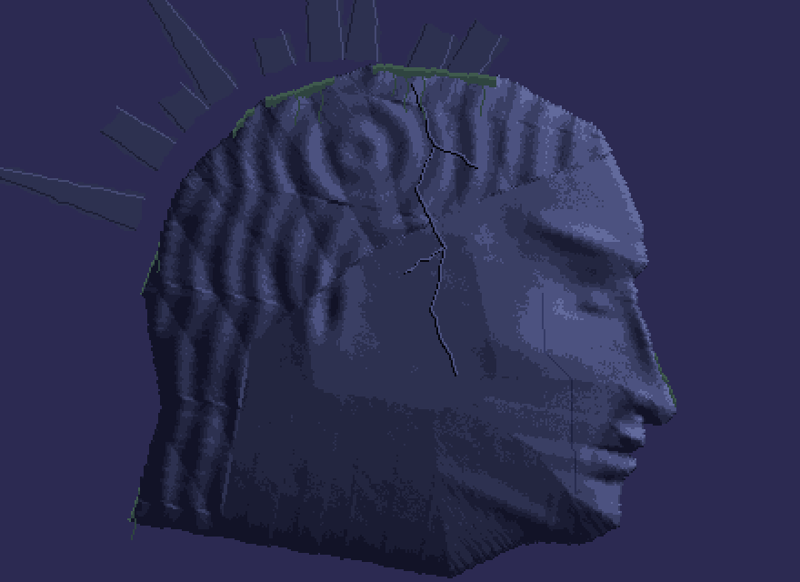
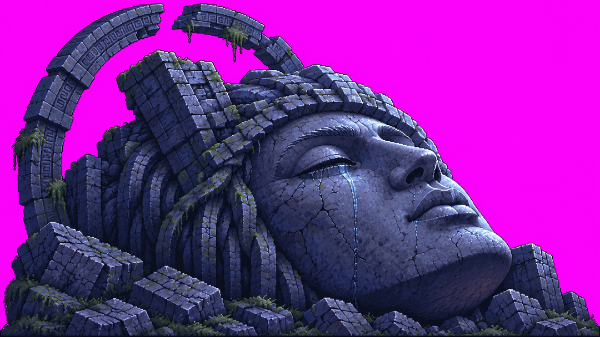
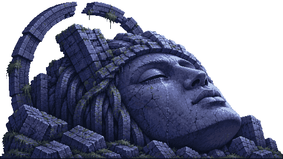
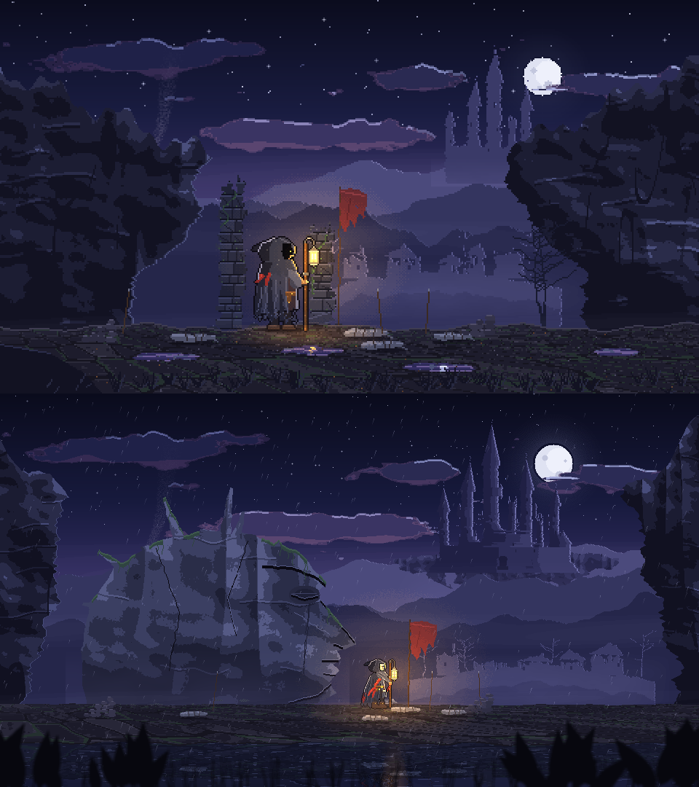
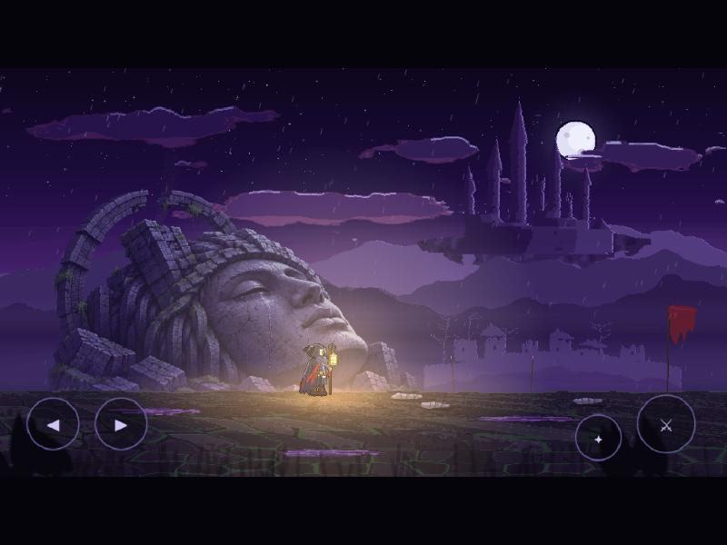
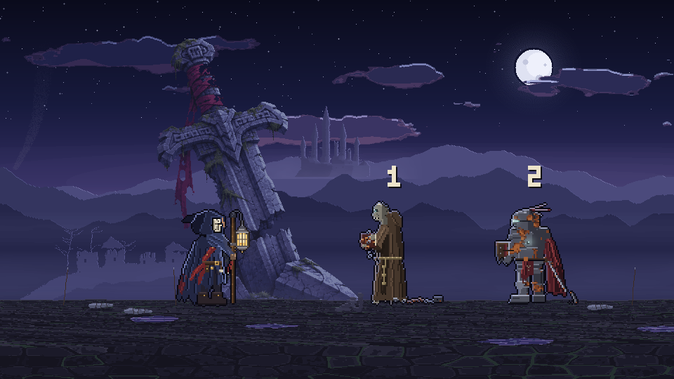

# Gün 1: Fikirden İlk Oynanabilir Sahneye

Tek bir günde bir ilham panosundan yola çıkıp, [yazı tabanlı oyunum Veyra: Kırık Ölüm](https://play.google.com/store/apps/details?id=com.ironcoreapps.veyra)'ün dünyasında geçen ve telefonda oynanabilen 2D piksel aksiyon sahnesine vardım.

---

## Bugün Ne Yaptım

Günün başında yalnızca bir görsel ilham panosu ve kafamdaki karanlık atmosfer vardı. Sıra tabanlı mekanikleri bir kenara bırakıp gerçek zamanlı 2D yandan görünümlü bir aksiyon dünyası kurmaya karar verdim.

Karakterimiz Korel'in piksellerle çizilmesinden başladık; adım adım sahneye kayalar, terk edilmiş bir köy, uzak bir kale, ışık alan su birikintileri ve devasa bir tanrı başı heykeli ekledik. Günün sonunda 6 katmanlı derinliğe (parallax) sahip, fener ışığıyla karanlığı aydınlatan, bekleme, koşu, saldırı ve Uğurla animasyonları çalışan bir web sürümü ortaya çıktı. Arkadaşlarımın telefonlarında test edebileceği canlı bir bağlantı açtım.

---

## Kullanılan Araçlar ve Teknikler

- **Claude (Kod ve Mantık):**
  - Phaser tabanlı oyun döngüsü ve 6 katmanlı parallax sahne mimarisi.
  - Prosedürel çevre algoritmaları: fbm (fractional brownian motion) gürültüsü, alan bükme (domain warping), siluet aşındırma.
  - Dinamik ışık: İlk sahne turlarında çarpımsal ısıtma ve yüzeylerde sıcak tonlama; oynanabilir sürümde Korel’le yürüyen fener ışığı için eklemeli karışım (ADD blending).
  - Hibrit piksel dönüştürücü: Codex'ten gelen yüksek çözünürlüklü illüstrasyonları alan ortalamasıyla küçültme, k-means (24 renk) kümeleme ile palete sabitleme ve arka plan pusuyla değer eşleme (value mapping).
- **Codex (Büyük Set Parçaları ve Atmosfer Çizimleri):**
  - Sahnedeki devasa tanrı başı heykeli, dev kırık kılıç ve yıkık geçit kapısı için illüstrasyon üretimi.
- **Tasarım ve Yönetmenlik (Bilal):**
  - "Matematiksel durmasın, cetvel hissi vermesin" kuralı.
  - Karakter kıyafeti seçimi (Maskeli Yasçı).
  - Ölçek kararı: Yakın kamera yerine uzaktan kamera ("Yüzüklerin Efendisi gibi, oyuncu devasa dünyada kendini küçük hissetsin").
- [pixel-art-engine](https://github.com/bilalfarukozdemir/pixel-art-engine): kendi açık kaynak piksel sanat motorum; kodla çizimler ve Codex görselini ızgara/palete oturtma bununla yapıldı.

---

## Adım Adım

### 1. Karakterin Doğuşu (Korel)
İlk denemede Korel'i 36 piksel olarak kodla çizdirdik. Yürüdü, koştu fakat teknik çalışsa da görsel olarak çok düz kaldı. İlham aldığımız panonun derinliğini yakalamak için karakter boyutunu 64 piksele çıkardık; kukuleta, yırtık kumaşlar ve elinde kafesli feneriyle karakter ete kemiğe büründü. Üç farklı kıyafet tasarımı arasından göğsünde yas kuşağı ve çatlak bir maskesi olan "Maskeli Yasçı" tasarımını seçtim.

### 2. Çevrenin İnşası ve "Organiklik" Savaşı
480×270 çözünürlükle başladığımız sahnede kayalar önce düz duvar gibi durdu, sütunlar cetvelle çizilmiş gibiydi, bulutlar ise elips şeklindeydi. Claude'a gürültü fonksiyonları ve siluet aşındırma ekleterek kenarları kırdık, kaleyi eğik kulelerle donattık, kayalara dikey tabakalar ve çatlaklar verdik.

### 3. Kamerayı Uzaklaştırmak (Ölçek Devrimi)
Sahne güzelleşiyordu ama bir şeyler eksikti. Karar anı burada geldi: Sahne çözünürlüğünü 480×270’ten 960×540’a çıkardık; Korel 64 piksel kaldı. Karakter ekranda küçüldü, arka plana devasa gotik kale ve yıkık heykeller yerleşti. Oyuncu o kasvetli coğrafyada küçücük kalınca aradığım epik atmosfer tam olarak oturdu.

### 4. Dev Set Parçaları: Kod mu, Yapay Zekâ mı?
Arka plana yıkılmış dev bir tanrı heykeli koymak istedik. Heykeli kodla çizdirmeye çalıştığımda sonuç tam bir felaket oldu. Bunun üzerine sistemi ikiye ayırdık:
- **Karakter, ışık, sis, yağmur, su birikintileri ve zemin koddan.**
- **Tanrı başı, dev kılıç ve yıkık kapı gibi devasa sanat parçaları Codex'ten.**

Codex'e düz macenta zemin üzerinde tanrı başı çizdirdik. Claude yazdığı özel bir betikle görseli 500 piksele indirdi, arka planı temizledi, 24 renkli k-means algoritmasıyla renkleri oyunun paletine kilitledi ve gece ışığına uydurmak için pusla harmanladı. İki yöntemin birleşimi harika çalıştı.

### 5. Telefonda Çalıştırma ve Yayın
3840 piksellik yürünebilir Gölge Geçidi sahnesini tarayıcıda çalıştırdım. İlk denediğimde tek kelimeyle ağzım açık kaldı. Dokunmatik sanal tuşları ekleyip projeyi web üzerinden yayına aldım.

---

## Yapay Zekânın Beceremediği Anlar

1. **Komik Tanrı Başı:**
   Kodla çizdirmeye çalıştığımız heykel başı yuvarlak bir kafatası, kenara sıkışmış gözler ve garip oranlarla çizgi film karakterine veya uzaylı maskesine benzedi. Bu kodla çizim denemelerinde hedeflediğimiz yüz ifadesini yakalayamadık.
2. **Matematiksel Düzen Hastalığı:**
   Bu sahnenin ilk kodla çizim denemelerinde kale, bulut ve kayalar fazla düzenli, eşit aralıklı ve cetvelle çizilmiş gibi görünüyordu. Doğadaki yıpranmışlığı, rastgeleliği ve çatlakları yakalamak için sürekli "aşındır", "düz hat bırakma", "aralıkları boz" diye zorlamak gerekti.
3. **Işık Halkaları (Bantlaşma):**
   Fener ışığını yumuşatmak için titreşimi (dither) kaldırdığımızda, ışık etrafında hedef tahtası gibi belirgin renk halkaları oluştu. Eklemeli ışığı yalnızca fenerin en yakınında tutarak çözebildik.
4. **Kendi Işığıyla Gelen Görseller:**
   Codex'ten aldığımız görsel kendi ışığıyla geliyordu. Sahneye ilk koyduğumuzda arka plana sonradan yapıştırılmış parlak bir çıkartma gibi durdu. Gece değerlerine eşleme (value mapping) yapılmadan sahneye oturmadı.
5. **Telefondaki Siyah Ekran Vakası:**
   Bilgisayarda çalışan sahne telefonda açıldığında yalnızca dokunmatik butonlar göründü; arka plan simsiyah kaldı. Telefon GPU’sunun doku boyutu sınırından şüphelendik (katmanlar 4712 piksele kadar genişti). Katmanları 1024 piksellik parçalara bölüp uç uca ekleyince sorun çözüldü.

---

## Dersler

- **Yapaylığı ayrıntı azlığı değil, düzenlilik yapar:** Dümdüz kenarlar, eşit aralıklı pencereler ve tekrarlayan desenler "yapay zekâ işi" hissini veren asıl unsurlar. Doğallık bozuklukta gizli.
- **Hibrit sistem en temizi:** Kod her şeyi çizmek zorunda değil; modeller de oyun motoru gibi davranamaz. Büyük atmosferik heykelleri görsel modele çizdirip kodla piksel paletine indirgemek iki tarafın da en güçlü yanını birleştiriyor.
- **Kamera mesafesi duyguyu belirler:** Karakteri ekranda dev gibi göstermek yerine kamerayı geriye çekip dünyayı büyütmek, oyuncuya o dünyanın ağırlığını hissettiriyor.
- **Telefonda erken test şart:** Masaüstü tarayıcısında canavar gibi çalışan dokular mobil donanımlarda anında patlayabiliyor.

---

## Bu Gün İzleyiciye Sorulan Soru

Gölge Geçidi'nde artık yürüyebiliyoruz ama henüz karşımızda bir tehlike yok. Oyunun ilk düşmanı "Geçemeyen" adında ölemeyen bir varlık olacak.

İzleyicilere iki seçenek sundum:

1. **Zincirli Keşiş:** Son tasarımda sıska, tonsürlü kel kafası, kahverengi cüppesi, zincirle sarılı kitabı ve ayak prangasıyla bir keşiş.
2. **Paslı Zırhlı Asker:** Göğsündeki ölüm yarasından ışık sızan, yerde sürünen çentikli kılıcı ve yırtık kızıl peleriniyle bir asker.

Bu adaylar henüz oyunda değil. Oylamada kazananı Gün 2’de yapmayı planlıyorum; iki seçenek de yapılacak.

---

## Görseller

### 1. Kodla Çizilen Tanrı Başı (Yontma Denemesi)
Komik bulunan önceki başın ardından yapılan yükseklik haritasıyla yontma denemesi:

### 2. Codex'ten Gelen Ham Görsel
Yapay zekâ görsel modeline düz zeminde ürettirdiğimiz devasa heykel illüstrasyonu:

### 3. Kod ile Izgaraya ve Palete İndirgeme
Claude'un yazdığı algoritmayla görselin 24 renge indirgenip piksel ızgarasına kilitlenmiş hali:

### 4. Sahne Ölçeği Karşılaştırması (480×270 → 960×540)
Kamerayı uzaklaştırıp dünyayı büyüttüğümüz anın ölçek kıyası:

### 5. İlk Oynanabilir An (Gölge Geçidi)
Tüm katmanların, fener ışığının ve devasa set parçalarının bir araya geldiği ilk sahne:

### 6. Gün 1 Oylama Kartı
İzleyicilere sunulan ilk düşman oylaması (Zincirli Keşiş mi, Paslı Zırhlı Asker mi?):

