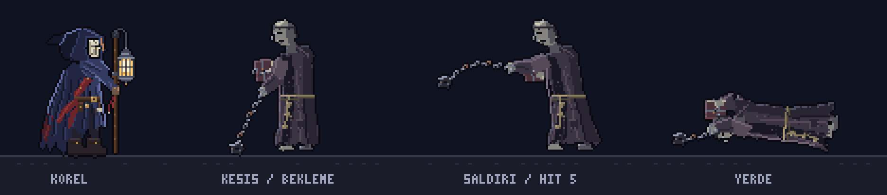
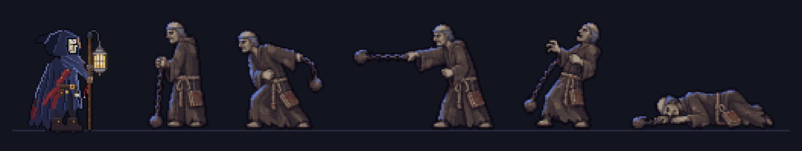
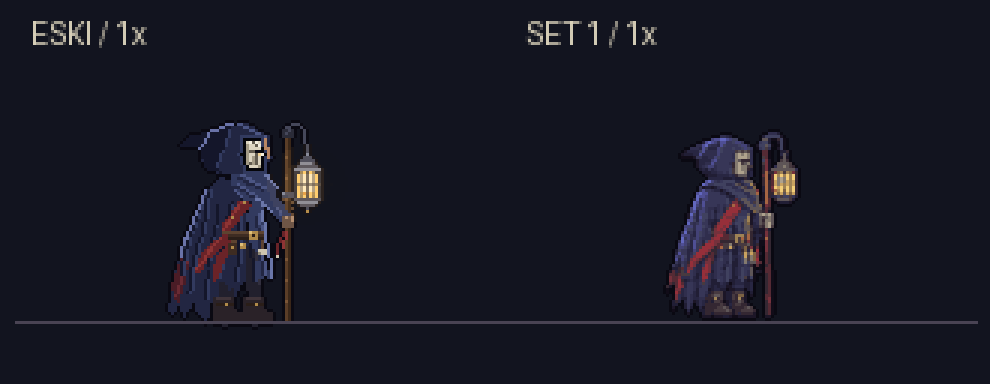
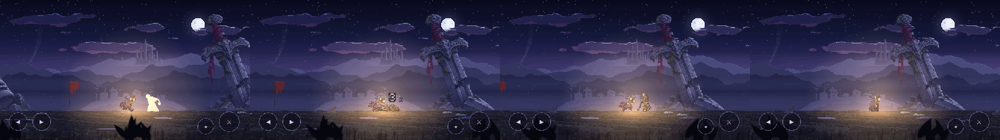
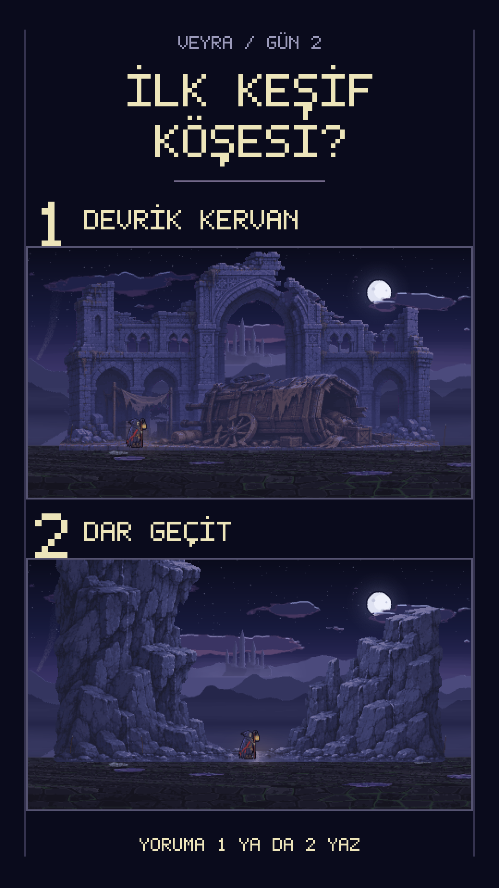

# Gün 2: İlk Düşman ve Uğurla

Gün 1 oylamasını Zincirli Keşiş 7–3 kazandı. İlk düşmanı yaparken beklemediğim bir şey oldu: Keşiş Korel’den kaliteli göründü, o yüzden Korel’i de yeniledim. Bir de düşmanı yere indirmenin dövüşü bitirmediği ilk mekaniği ekledim.

---

## Bugün Ne Yaptım

Dün Gölge Geçidi’nde yürüyebiliyordum ama karşıma çıkan bir tehlike yoktu. Bugün oylamanın kazananını sahneye aldım: yaklaşan, mesafe tutan ve zincir savuran Zincirli Keşiş.

Önce kodla çizdirdim ama Korel’in yanında zayıf kaldı. Codex’in ürettiği pozları Claude’un koduyla gerçek piksel ızgarasına ve gece paletine oturtunca istediğim görünüme yaklaştım. Sonuç bu kez Korel’i geride bırakınca kahramanı da aynı yöntemle yeniledim. Günün sonunda dört vuruşta yere inen, üç saniye içinde Uğurlamazsam geri kalkan, Uğurlarsam kül olup dağılan bir düşmanla dövüşebiliyordum.

---

## Kullanılan Araçlar ve Teknikler

- **Claude (Kod ve Mantık):**
  - Keşişin durum makinesi, vuruş kontrolü, hazırlık ve karşılık verme pencereleri.
  - Yere inişten sonra başlayan üç saniyelik sayaç, piksel rakamlar ve Uğurla akışı.
  - Codex görsellerini arka plandan ayırma, küçültme, ortak palete kilitleme ve animasyon karelerine dönüştürme.
- **Codex (Görseller ve Test):**
  - Keşiş ve Korel için karma yöntemde kullanılacak karakter pozları.
  - Test ajanıyla tarayıcıda dövüşü baştan sona oynama; düşük FPS saati, atlas boyutu ve keşişin aynalanmasıyla ilgili üç hatanın bulunması.
- **Tasarım ve Yönetmenlik (Bilal):**
  - İki karakter için de Set 1’i seçtim.
  - Kodla çizim zayıf kalırsa önce düzeltme turu, yetmezse Codex görseli ve ızgara/palet kilidi kuralını benimsedim.
  - Ölüm anını oylamaya açmadım; dünyanın ölüm kurallarına sadık kaldım.
- [pixel-art-engine](https://github.com/bilalfarukozdemir/pixel-art-engine): motor güncellendi; saydam piksel harmanlama, organik çizim yardımcıları, görüntü işleme ve sprite sheet çıktısı geliştirmeleriyle test sayısı 29’dan 68’e çıktı. Bu güncellemeler GitHub’daki ana sürümde yayında.
- **FFmpeg ve Vulkan kullanan başsız Chrome:** Görüntü dönüşümündeki uyumu korumak ve akıcı oyun kaydı almak için kullandım.

---

## Adım Adım

### 1. Oylamadan İlk Düşmana
İzleyicinin seçtiği Zincirli Keşiş’i önce kodla çizdirdim. Bekleme, saldırı ve yerde yatma pozları vardı; teknik olarak düşman okunuyordu ama Korel’in yanına koyunca fark ortaya çıktı. Gri cüppe ve zombi gibi duran yüz, aradığım keşiş hissini vermedi. Hareket etmesi, çizimi kabul etmem için yeterli değildi.

### 2. Karma Yöntemi Karaktere Taşımak
Gün 1’de büyük set parçalarında işe yarayan yöntemi bu kez karakterde denedim. Codex’in beş pozunu doğrudan oyuna koymadım. Claude’un kodu arka planı temizledi, kopuk zincir parçalarını ilgili gövdeyle birlikte ayırdı ve pozları ortak ölçekte yaklaşık 70 piksele indirdi.

Beş pozu birlikte palete kilitledik; böylece her pozda renklerin yeniden değişmesini önledik. 23 renkli kümeye koyu kontur eklenince 24 renkli sonuç çıktı. Gece renklerine eşleyip Korel’in yanında karşılaştırdım ve Set 1’i seçtim. Bu beş kaynak poz, sonrasında sekiz animasyon ve 52 karelik keşiş setine dönüştü; kaynak pozla oynatılan animasyon karesi aynı şey değil.

### 3. Keşiş Korel’i de Yeniletti
Yeni keşişi sahnede görünce bu kez Korel’in geride kaldığını düşündüm. O yüzden kahramanı da aynı karma hatla yeniledim ve onun için de Set 1’i seçtim. Yalnız çizimi değiştirmek yetmedi: Fenerin ışığını yeni karelerdeki konumuna bağladık. Görselin elindeki fenerle sahnedeki ışığın birlikte hareket etmesi gerekiyordu.

### 4. Dört Vuruş, Sonra Üç Saniye
Keşiş orta mesafeden zincir savuruyor. Saldırının 400 ms hazırlığı var; hamleyi okuyup kaçabilmem için savurmadan önce zaman bırakıyor. İsabetlerde kısa duraklama ve ekran sarsıntısıyla darbeyi hissettirdik.

Dört vuruşta yere iniyor ama bu, onu geçirdiğim anlamına gelmiyor. Yere iniş animasyonu bitince bedeninin üzerinde piksel **3–2–1** sayacı başlıyor. Üç saniye içinde yakınına gelip Uğurla’yı başlatırsam kül oluyor; süreyi kaçırırsam tam canla yeniden kalkıyor. Dün yalnızca oynatabildiğim Uğurla animasyonu bugün dövüşte bir işe yaradı. Ölüm anını izleyiciye sormadım; bu dünyanın temel kuralını koruyup oylamayı sıradaki keşif köşesine ayırdım.

### 5. Motor Geçişi ve Tarayıcı Testi
Oyunda kullandığımız genel çizim yardımcılarını kendi motoruma taşıdık. Saydam piksellerin üst üste gelmesini düzelttik; gürültü ve organik çizim araçlarının yanına arka plan temizleme, palet sınırlama, tek tük piksel temizliği, PNG okuma ve kareleri şeritte toplama araçları geldi.

Geçişte eski çıktıyla piksel farkı oluştu. Motorun alan küçültmesi FFmpeg’den farklı yuvarlıyordu; ardından k-means bu küçük farkı büyütüyordu. Eski karma dönüşümde küçültmeyi FFmpeg’de bırakınca karşılaştırmada 0 piksel farka ulaştık. Bu sonuç, saydam harmanlama düzeltmesinin fener halesinde yaptığı bilinçli değişiklikten ayrıydı.

Codex test ajanına da dövüşü tarayıcıda baştan sona oynattım. Üç hata bulundu ve düzeltildi: düşük FPS’te zamanın yanlış ilerlemesi, uzun atlasın GPU sınırına takılması ve keşişin ters aynalanması. Yalnız testlerin geçmesine bakmak yerine oyunun gerçekten oynanması burada işe yaradı.

---

## Yapay Zekânın Beceremediği Anlar

1. **Çalışan Ama Zayıf Kalan Keşiş:**
   Kodla çizilen ilk keşişte pozlar vardı ama cüppe ve yüz Korel’in yanında sönük kaldı. Kodla çizimde ısrar etmek yerine düzeltme turlarının ardından karma yönteme geçtim.
2. **Küçük Piksel Farkının Büyümesi:**
   Aynı işi yaptığını düşündüğümüz iki küçültücü aynı sonucu vermedi. Yuvarlama farkı palet kümelenmesini de değiştirince motor geçişini yalnız işlev adlarına bakarak doğrulayamayacağımı gördüm. Eski çıktıyla piksel karşılaştırması yaparak çözdük.
3. **Kodun İçinden Görünmeyen Üç Hata:**
   Sayaç, atlas ve aynalama sorunları tarayıcıda oynayınca ortaya çıktı. Saati düzelttik, atlası GPU’ya göndermeden uygun boyutta paketledik ve yeni çizimin baktığı yöne göre aynalamayı değiştirdik.
4. **Takılan Video Kaydı:**
   Yazılım GL ile kayıt yaklaşık 10 FPS’e takılıyordu. Sorun oyunu yeniden çizdirmekle çözülmedi; ekran kartını kullanan Vulkan destekli başsız Chrome’a geçince oyun 60 FPS, video 30 FPS oldu. Kayıt ortamı da sonucu belirliyormuş.

---

## Dersler

- **Aynı sahnede yan yana karşılaştır:** Keşiş tek başına çalışıyordu ama Korel’in yanında zayıflığı ortaya çıktı. Yenilenince de bu kez Korel’in geride kaldığını gördüm.
- **Yöntemi sonuca göre değiştir:** Önce kodla denemek ve düzeltmek işe yarıyor; kalite hâlâ gelmiyorsa görsel modeliyle kodun birlikte çalışmasına alan açmak gerekiyor.
- **Paleti pozlar arasında sabitle:** Her pozu ayrı renklendirmek yerine birlikte kümelemek, karakterin hareket ederken renk değiştirmesini önlüyor.
- **Motor geçişini gözle ve pikselle denetle:** Aynı algoritma adı, aynı yuvarlama ve aynı çıktı demek değil. Küçük fark sonraki işlemde büyüyebiliyor.
- **Ajan oyunu da oynasın:** Tarayıcı testi, sayaçtan çizimin yönüne kadar kodun tek başına göstermediği sorunları yakaladı.

---

## Bu Gün İzleyiciye Sorulan Soru

İlk düşman artık sahnede. Sırada ana yolun yanına ekleyeceğim ilk keşif köşesi var.

İzleyicilere iki seçenek sundum:

1. **Devrik kervan:** Devrilmiş araba ve kervansaray çevresinde küçük bir keşif cebi.
2. **Dar Geçit:** Yüksek kaya duvarları arasında dar bir yürüyüş bölümü.

Bunlar sıradaki alan için adaylar; bugün ikisini de bitirmiş değilim. Videonun kapanışında “İlk keşif köşesi?” diye sorup yorumlara 1 ya da 2 yazılmasını istedim.

---

## Görseller

### 1. Kodla Çizilen İlk Keşiş
Bekleme, saldırı ve yerde yatma pozlarını Korel’in yanında karşılaştırdığım ilk çizim:

### 2. Karma Yöntemle Keşiş — Set 1
Codex’in beş pozunun ızgara, ortak palet ve gece renklerine oturtulmuş hali; solda önceki Korel var:

### 3. Korel’in Eski ve Yeni Hali
Keşişin ardından aynı yöntemle yenilediğim Korel; karşılaştırma oyun ölçeğinden büyütüldü:

### 4. Dövüşten Kareler
Oyun kaydından farklı anlar; ikinci karede yerdeki keşişin üzerinde 3 rakamı görünüyor. Şerit, iki sonucu tek kesintisiz olay olarak göstermiyor:

### 5. Gün 2 Oylama Kartı
Sıradaki keşif köşesi için sunduğum iki adayın görsel önerileri:

