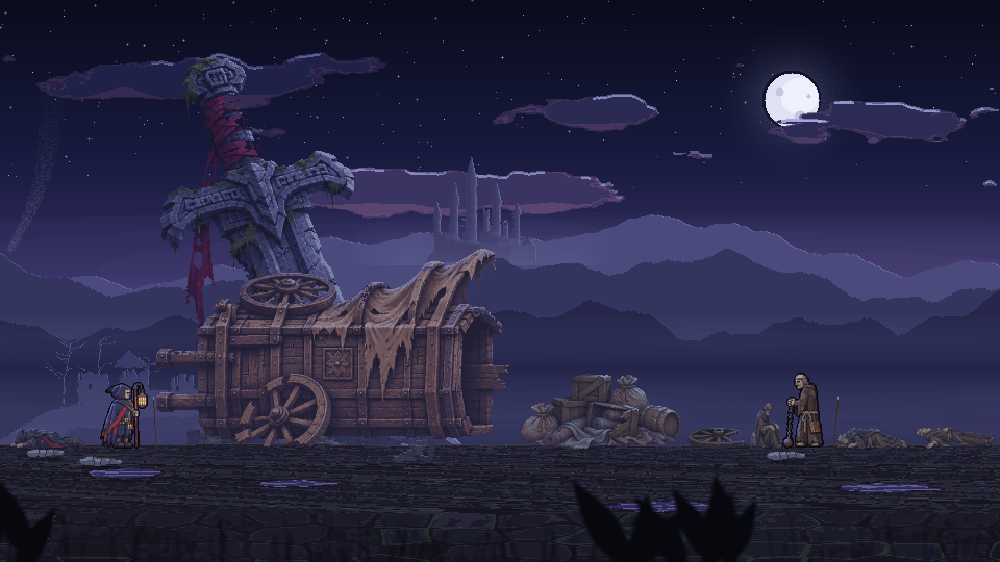
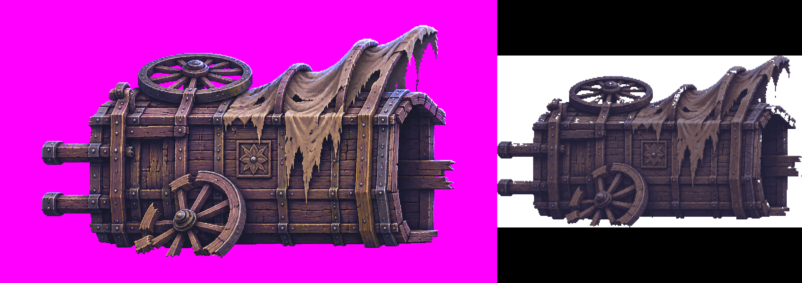
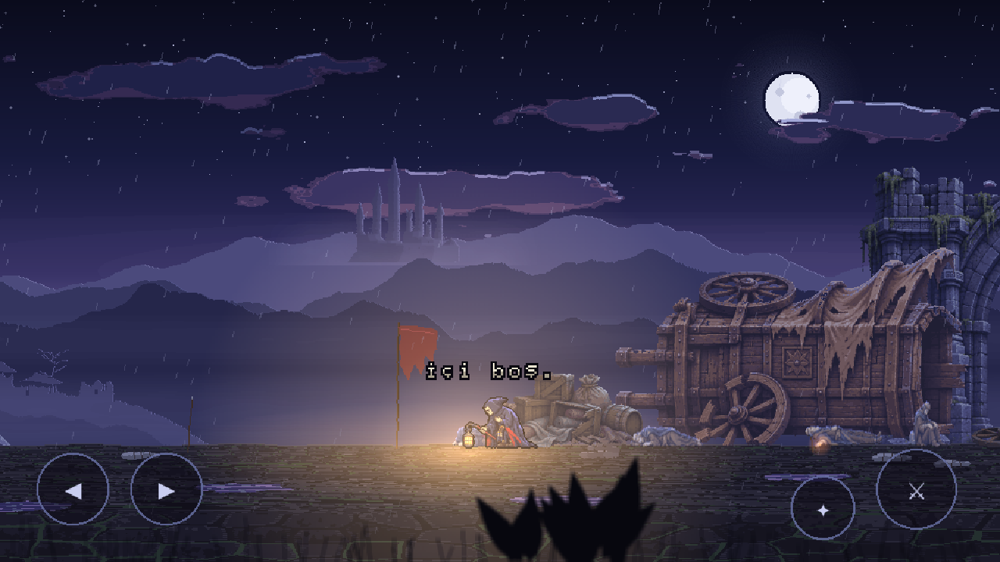
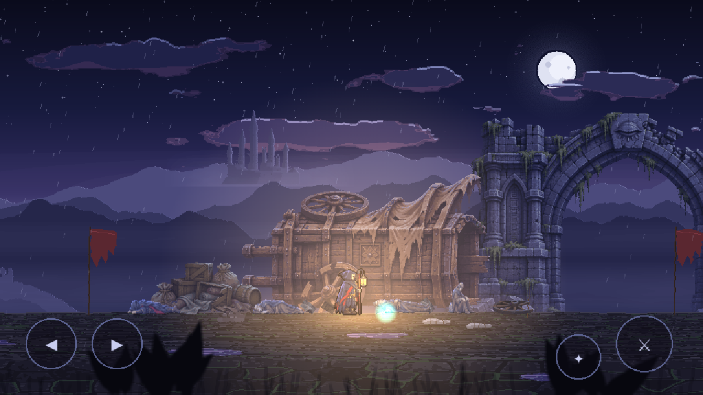
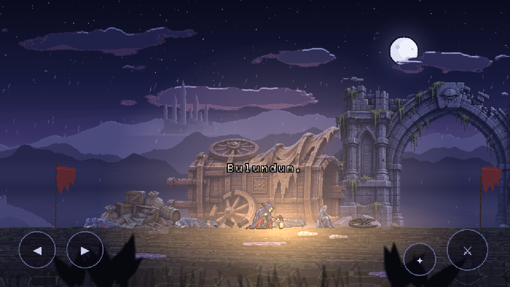
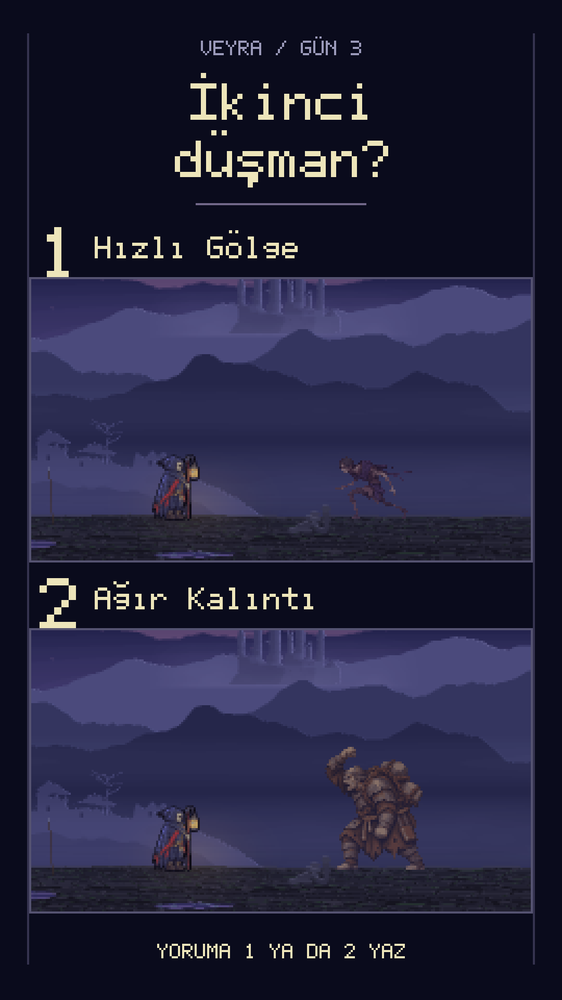

# Gün 3: Devrik Kervan ve İçi Boş Bedenler

Gün 2’de “İlk keşif köşesi?” diye sormuştum. Devrik kervan kazandı. Bugün o kervanı yaparken dün öğrettiğim Uğurla tuşunu bir yerde çalışmaz hâle getirdim. Tuş bozuk değil; Korel’in karşısındaki bedenlerde uğurlanacak bir şey kalmamış.

---

## Bugün Ne Yaptım

Korel’in birlikte yolculuk ettiği kafileyi avluya yerleştirdim. Devrilmiş araba, yük, kopmuş teker ve dört beden var. Bedenlerde yara yok ama içleri boşaltılmış. Korel bir mezarcı; ölüleri uğurluyor, bu insanları ise uğurlayamıyor. Yanlarında tuşa basınca “İçi boş.” yazıyor ve gri bir toz kalkıp sönüyor.

Avluya uyuyan ikinci bir Zincirli Keşiş de ekledim. Onu uğurlayınca yaşlı tüccar Hüsrev’in açık avucunda oyunun ilk turkuaz ışığı beliriyor. Bir yandan da karşılaşmaları ve etkileşimli nesneleri tek veri dosyasına taşıttım. Her gün yalnız anketin istediği parçayı yaparsam oyun bitmez; bugün içerik ekleme işini de kolaylaştırmak istedim.

---

## Kullanılan Araçlar ve Teknikler

- **Claude (Plan ve Denetim):**
  - Şef olarak planı kurdu, işleri böldü ve gelen kanıtı kontrol etti.
  - Hikâye kurallarıyla sahnedeki davranışın birbirini tutmasına baktı; kendi yorumunu da düzeltmek zorunda kaldı.
- **Codex (Kod, Görseller ve Test):**
  - Bağlam toplayan 3, yazan 6 ve denetleyen 2 ayrı oturumla çalıştı.
  - Kodu, çizimi ve denetimi ayrı ajanlar üstlendi. Her yazma işinin ardından ayrı bir denetçi oturumu baktı.
- **Karma çizim:** Codex görseli, piksel ızgarası, 24 renk ve sahnenin gece tonuna uyarlama sırasını kullandım. Her nesne için birden çok denemeden birini seçtim.
- **Veriyle içerik:** Karşılaşmalar ve etkileşimli nesneler `icerik.json` dosyasına taşındı. Yeni düşman ya da nesne eklemek artık birkaç satır veriyle yapılabiliyor.
- **pixel-art-engine:** Açık kaynak motoruma `rotateImage`, `scatterPoints` ve `dustPuff` eklendi. Üç yardımcı aynı gün PR #6 ile yayınlandı; test sayısı 68’den 85’e çıktı.

---

## Adım Adım

### 1. Kervanı Bir Dekordan Fazlası Yapmak
Devrik kervan seçilince yalnızca yol kenarına bir araba koymak istemedim. Burası Korel’in birlikte yol aldığı kafile. Yerdeki insanlar onun uğurlayabildiği ölülerden farklı; bedenlerinde yara olmamasına rağmen içleri boşaltılmış. Mezarcının bildiği iş burada sonuç vermiyor.

Dünkü mekaniği hatırlayan oyuncunun önce aynı tuşu denemesini istedim. Korel bedenin yanına geldiğinde Uğurla’ya basabiliyor ama sonuç kül olmak değil: “İçi boş.” yazısı ve sönüp giden gri toz. Böylece yeni köşe, yalnız bakılacak bir çizim olmaktan çıkıp önceki gün öğrendiğim hareketi yeniden düşündüren bir yere dönüştü.

### 2. Aynı Tuşa İki Ayrı Cevap
Avluda ikinci bir Zincirli Keşiş uyuyor; Korel yaklaşınca kalkıyor. O bir Geçemeyen, dolayısıyla uğurlanabiliyor. Dört vuruşla yere indirip üç saniye içinde Uğurla’yı kullanınca kül oluyor. Bedenlerde sonuç vermeyen hareket burada çalışıyor.

Bu farkı açıklayan uzun bir metin koymak yerine aynı eylemin sonuçlarını yan yana getirdim. Oyuncu bir bedende boşlukla, Keşiş’te ise uğurlanabilen biriyle karşılaşıyor. Benim için sahnenin asıl işi buydu: Dün tuşun nasıl kullanıldığını öğretmiştim, bugün her bedene aynı sonucu vermediğini göstermek istedim. Yeni bir tuş eklemeden mevcut hareketin anlamını genişlettim.

### 3. Oyunun İlk Turkuazı
Keşiş uğurlanınca Hüsrev’in açık avucunda kalp ritmiyle atan turkuaz bir ışık beliriyor. Rengi rastgele seçmedim. Dünyanın renkleri gece mavisi, mor ve sıcak fener ışığı; turkuaz yalnız Nara gücüne ait. Bu yüzden avuçtaki küçük ışık, çevresindeki nesnelerden farklı bir anlam taşıyor.

Korel parçayı alınca ekranda “Bulundum.” yazıyor. Sonrasında feneri ve göğsündeki küçük turkuaz nokta kalp ritmiyle atmaya başlıyor. Burada renk, yazı ve hareketin aynı şeyi anlatması gerekiyordu. İlk turda bunu tutturamadık; hikâye kurallarını yeniden okuyunca hem ışığın rengini hem repliği değiştirmek zorunda kaldık.

### 4. Arabayı Çizmek, Bedenleri Görünür Kılmak
Araba, yük, teker ve bedenleri önce Codex’e çizdirdim; sonra seçtiğim denemeleri ızgaraya ve 24 renge indirip gece tonuna oturttum. Parçaları Korel ve Keşiş’le aynı sahnede karşılaştırdım. Tek başına iyi duran bir nesnenin oyundaki ölçeğini böyle görebiliyorum.

Bedenler sahnede fazla karanlık kaldı. Yeniden görsel üretmek yerine kodla soğuk bir kenar ışığı eklettim. Böylece eldeki çizimi koruyarak okunmasını iyileştirdik. Tam yandan görünüm isteği ise bütünüyle tutmadı; araba ve yükte hafif üstten bakış kaldı. O kısmı öyle bıraktım.

Yerdeki döküntüyü de ayrı ayrı çizdirmedim. Yük görselinden kesilen dört parçayı `rotateImage` ile döndürüp `scatterPoints` ile 11 yere saçtık. Döndürme en yakın komşu yöntemiyle pikselleri koruyor; saçma ise tohumlu çalışıyor ve noktalar arasında en az uzaklık bırakıyor. `dustPuff` da toz efekti için eklendi. Sahne için gereken bu işler motorun tekrar kullanılabilecek yardımcılarına dönüştü.

### 5. Anketin Yanında Altyapıyı da İlerletmek
Karşılaşmaları ve etkileşimli nesneleri kodun içinden çıkarıp `icerik.json` dosyasında toplattım. Dosyada düşmanın türü ve konumu, nesnenin görseli ve etkileşimi gibi bilgiler duruyor. Yeni içerik eklerken aynı sahne kodunu tekrar tekrar değiştirme ihtiyacını azaltmak istedim.

Bu işi anket istemedi. Yine de günün parçası yaptım; yalnız izleyicinin seçtiği nesneyi eklemek uzun vadede yeterli olmayacak. Kervan bugün görünür sonuçtu, veri dosyası ise sonraki içerikleri ekleme biçimimi değiştirdi. İkisini birlikte ilerletmek, günlük bir sahne üretmenin yanında oyunun devamını da düşünmemi sağladı.

---

## Yapay Zekânın Beceremediği Anlar

1. **Şefin Yanlış Okuduğu Hikâye:**
   Claude avuçtaki ışığı kehribar, yazıyı “Parça atıyor.” diye yazdırdı. Hikâye raporunu yeniden okuyunca bunun Nara kırığı olduğunu gördük. Turkuaz ve “Bulundum.” için bir tur daha gerekti.
2. **Oyunda Olmayan Hata:**
   Şef “yazılar ekranda görünmüyor” diye hata raporu açtı. Sorun test betiğindeydi: Tarayıcı sayfası odakta olmadığı için gönderilen tuş oyuna ulaşmamıştı.
3. **“Kalan Sorun Yok” Raporu:**
   Motor yardımcılarını yazan küçük model böyle dedi ama denetçi üç hata buldu. Çok küçük açılarda görüntü kırpılıyor, negatif nokta sayısında işlem çöküyor, negatif uzaklık da pozitif gibi uygulanıyordu.
4. **Eksik Türkçe Harfler:**
   Piksel yazı tipinde Türkçe harflerin bir kısmı yoktu. “İçi boş.” yazısını gösterebilmek için eksikleri ekledik. Doğru metni yazdırmak tek başına yetmedi.
5. **Görünmeden Biten Toz:**
   Toz efekti 380 milisaniyede bitiyordu; kimse göremiyordu. Süresini uzattık. Efektin kodda bulunması, oyuncunun onu fark ettiği anlamına gelmedi.
6. **Tutmayınca Kabul Ettiğim Açı:**
   Çizimde tam yandan görünüm istememe rağmen araba ve yükte hafif üstten bakış kaldı. Bu kez yeniden üretmek yerine mevcut sonucu kabul ettim.

---

## Dersler

- **Denetçi raporu değil testi okusun:** “Sorun yok” cümlesi motor yardımcılarındaki uç durumları kapsamıyordu. Küçük açı, negatif sayı ve negatif uzaklık ayrıca denenmeli.
- **Şef de yanılır:** Hikâye raporunu işi dağıtmadan ikinci kez okumak, yanlış renk ve replik için harcadığım düzeltme turunu önlerdi.
- **Hata raporundan önce test aracını doğrula:** Yazı görünmüyorsa önce tuşun oyuna ulaştığına bakmalıyım. Odakta olmayan sayfa, çalışan oyunu bozuk gösterebildi.
- **Görseli yeniden üretmeden kodla ışığı dene:** Karanlık bedenleri yeni çizim yerine soğuk kenar ışığıyla daha okunur yaptım. Sorun çizimin kendisinde olmayabilir.
- **Anketin yanında içerik ekleme yolunu da düzelt:** Kervanı bitirmek bugünü ilerletti; nesneleri veriye taşımak sonraki günlerde aynı işi tekrar yapma ihtiyacını azalttı.

---

## Bu Gün İzleyiciye Sorulan Soru

Kervanın ardından sıradaki düşmanı izleyiciye sordum. İki aday da Geçemeyen: ölememiş, yolda kalmış insanlar.

İzleyicilere iki seçenek sundum:

1. **Hızlı Gölge**
2. **Ağır Kalıntı**

Bunlar ikinci düşman için adaylar. Kapanışta “İkinci düşman?” diye sorup yorumlara 1 ya da 2 yazılmasını istedim.

---

## Görseller

### 1. Kervan Parçalarının Ölçek Kıyası
Araba, yük, teker ve bedenler; solda Korel, sağda Zincirli Keşiş ile aynı sahnede ölçek karşılaştırması:

### 2. Codex Kaynağından Piksel Izgarasına
Solda macenta zeminli araba kaynağı, sağda ızgara ve gece paletine oturtulan oyun görselinin en yakın komşuyla büyütülmüş hali:

### 3. İçi Boş
Korel bedenin yanında eğilmişken ekranda “İçi boş.” yazıyor; arkasında yük ve devrik araba var:

### 4. Hüsrev’in Avucundaki Işık
Korel’in önünde, yerde yatan Hüsrev’in avucu çevresinde turkuaz ışık görünüyor:

### 5. Bulundum
Korel’in eğildiği anda “Bulundum.” yazısı görünüyor. Tek kare, ışığın kalp ritmini göstermiyor:

### 6. Gün 3 Oylama Kartı
İkinci düşman için Hızlı Gölge ve Ağır Kalıntı önerileri, Korel’in karşısında gösteriliyor:

