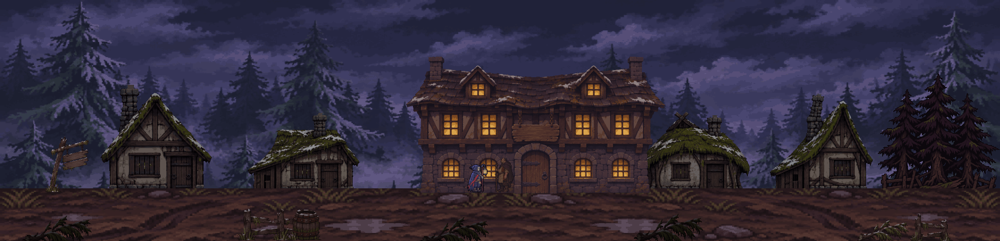
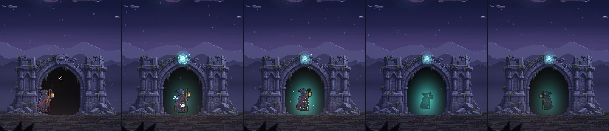
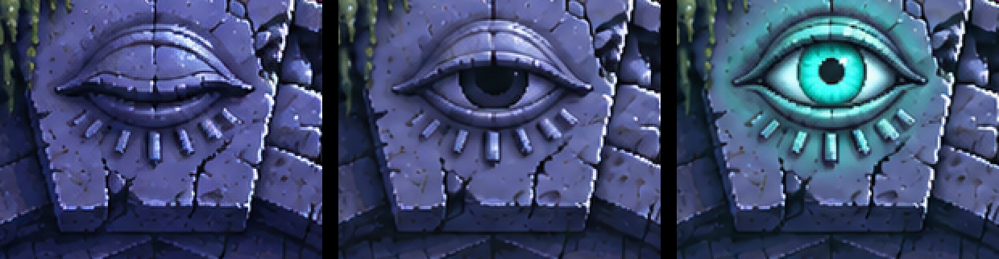
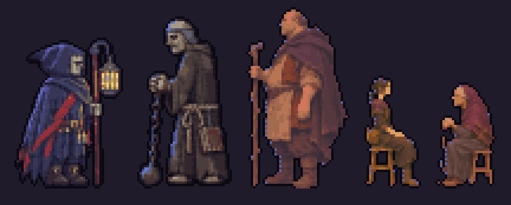
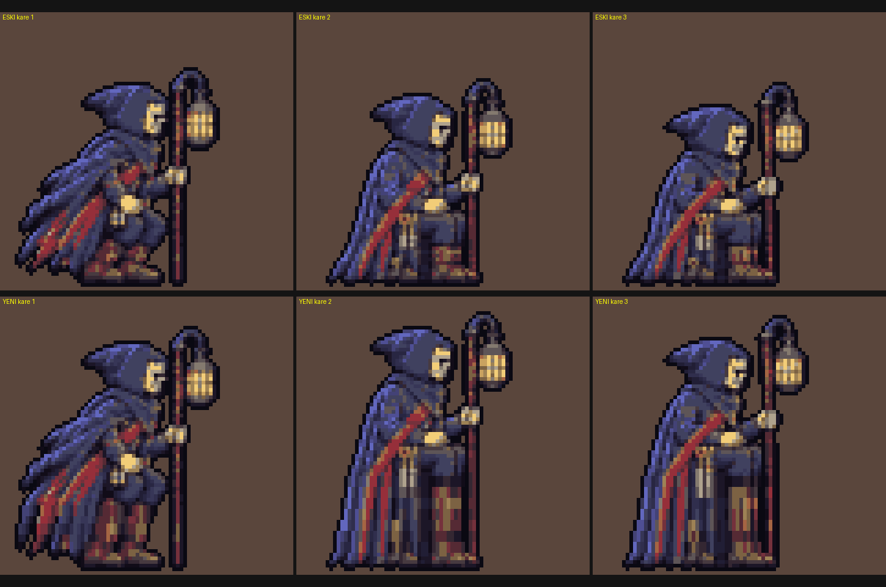
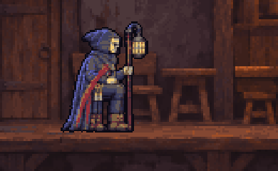

# Gün 4: Eşik Köyü ve Hanın Kapısı

Gün 3’te “Önce nereyi ekleyelim?” diye sormuştum; yorumlarda Han Salonu kazandı. Bugün Eşik köyünü ve hanı oyuna ekledim. Ama bir iç mekân çizdirmek yetmedi: Telefonda ilk denemede Korel’in neredeyse kapı boyunda olduğunu ve oturmasının garip durduğunu gördüm. Oturma pozlarını yeniden çizdirdikten sonra telefondaki ikinci denemede bu kez sandalyenin içine geçtiğini fark ettim.

---

## Bugün Ne Yaptım

Birinci haritanın sonundaki gözlü taş kemeri geçiş kapısı yaptım. Önceden arka planda duran kemer artık oyun düzleminde. Haritanın kenarından geçişi kaldırdım; kemerin önünde etkileşim tuşuna basınca göz açılıyor, turkuaz ışık yayılıyor ve Korel kemerin içine girerek Eşik köyüne geçiyor.

Köy ayrı bir harita: göknar ormanı, sis, çamur yol ve karlı çatılar var. Ortasında Doran’ın Hanı duruyor. İçeride şömine, masalar, sessizce bir şeyler içen köylüler ve ateşin önünde yaşlı bir köpek var. Burası oyunun ilk iç mekânı ve ilk dövüşsüz yeri. Celen ve Mira masada oturuyor; henüz konuşmuyorlar.

Kapı geçişinin yanında karakterlerin paletini, Korel’in handaki ölçeğini ve oturmasını da değiştirdim. Günün önemli kısmı, ilk sonucun nerede bozulduğunu görmek ve düzeltmekle geçti. [Web demosu](https://veyra-aksiyon.vercel.app) Eşik köyü dahil güncellendi.

---

## Kullanılan Araçlar ve Teknikler

- **Claude (Kod):** Yazan ajan olarak çalıştı. İşi birden çok yapay zekâ ajanına bölüyorum.
- **Codex (Görsel ve Denetim):** Görsel işlerini ve denetimi üstlendi. Yazan ve denetleyen ajanlar farklı sağlayıcılardan.
- **Yapay zekâ görsel aracı:** Açık göz kareleri ve Korel’in oturma pozları üretildi. Kapıda yalnız göz bölgesi orijinal görselin üstüne bindirildi; oturma pozları piksel ızgarasına ve palete indirildi.
- **Ortak renk bütçesi:** Doran, Celen ve Mira için Korel’le aynı 24 renk bütçesi, koyu kontur ve seyrek soğuk kenar ışığı kullanıldı.
- **Oynayarak ve kare kare denetim:** Ben telefonda denedim; denetçi ajanlar geçiş davranışını, testleri ve tarayıcıdan alınan kareleri kontrol etti.

---

## Adım Adım

### 1. Arka Plandaki Kemeri Kapıya Çevirmek

Birinci haritanın sonunda kilit taşında kapalı göz olan harabe bir taş kemer vardı. Onu oyun düzlemine aldım. Artık köye gitmek için haritanın kenarına yürümek yerine kemerin önünde etkileşim tuşuna basılıyor.

Göz önce yarı, sonra tam açılıyor. Turkuaz ışık yayılıyor, kemerin içi aydınlanıyor. Korel içeri yürüyüp küçülerek soluyor; ekran kararıyor ve Eşik köyü açılıyor. Geçiş yaklaşık üç saniye sürüyor. Köyden dönünce Korel kemerin içinden çıkıyor, göz açık kalıyor.

Gözün açık hâllerini yapay zekâ görsel aracıyla ürettim. Bütün kemeri değiştirmek yerine yalnız göz bölgesini orijinal çizimin üstüne bindirdim. Böylece aynı kapının açılmasını gösterebildim.

### 2. Doran’ın İzniyle Hana Girmek

Köyün ortasındaki hana gelince Doran durduruyor: “Dur orada. Kuzey yolundan geliyorsun.” Korel, “Sıcak bir köşe istiyorum. Bir bardak su. Param var.” diyor. Doran’ın cevabı: “Gir. Köşede otur, sessizce. Ben Doran.” Replikler bitmeden kapıdan girilemiyor.

İçerisi, dışarıdaki yolun ardından oyunun ilk dövüşsüz yeri. Şömine ve masalar var; Korel loş köşeye oturabiliyor. Masadaki Şifacı Celen ve Kör Mira henüz konuşmuyor. Sıradaki oylama, hangisinin Korel’in yanına önce geleceği üzerine.

### 3. Karakterleri Arka Plandan Ayırmak

Doran, Celen ve Mira önceden koyulaştırılmıştı ve bu yüzden arka plana karışıyorlardı. Etkileşimli karakterlerin Korel ve Zincirli Keşiş gibi seçilmesi gerekiyordu.

Üçüne koyu kontur, Korel’le aynı 24 renk bütçesi ve seyrek soğuk kenar ışığı uyguladık.

### 4. Telefonda Görülen İki Sorun

Oyunu telefonda denediğimde Korel handaki öteki karakterlere göre abartılı büyüktü; neredeyse kapı boyundaydı. Handa yüzde 20 küçülttük.

İkinci sorun oturmaydı. Bekleme karesi kırpılarak oturmuş gibi gösteriliyordu ve garip duruyordu. Yapay zekâ görsel aracıyla çömelme, oturma, oturuşta nefes ve kalkma pozları çizdirdim. Sonra bunları ızgaraya ve palete indirdik.

### 5. Bacakları Uzatırken Botları Bozmak

Pozlar yeniden çizildikten sonra telefondaki ikinci denemede “otururken sandalyenin içine geçiyor” dedim. İlk düzeltme denemesinde bacak satırlarını kopyalayarak uzattık. Botlar çizgili sütunlara döndü. Uzunluk artmıştı ama bacağın ve botun biçimi bozulmuştu.

Bu yolu bıraktık. Oturma karelerini doğru bacak oranıyla yeniden çizdirdik. Burada piksel satırını çoğaltmak, pozu düzeltmenin yerini tutmadı. Başarısız kıyası da aşağıya koydum; görselde “yeni” yazan alt sıra, son kabul edilen sonuç değil, bıraktığımız esnetme denemesi.

### 6. Denetçinin Gördüğü Başka Sorunlar

Köyden dönüş sinematiği sırasında basılan dokunmatik düğme, kontrol geri gelince Korel’i yeniden köye gönderiyordu. Denetçi bunu yakaladı. Bir testin de sahne geçişini bağlayan olay adı bozulduğunda bile geçtiği görüldü; artık bu bozulma testi kırmızıya düşürüyor.

Oturma işinde animasyon ile konumun iki ayrı saatle ilerlediği bulundu. Tarayıcıda kare kare kayıt alan ajan kemerin içinin karanlık yerine amber olduğunu, Korel’in atılma pozuyla girdiğini ve sütunun önünden geçtiğini gördü. Bu üç görsel sorun düzeltildi.

---

## Yapay Zekânın Beceremediği Anlar

1. **Kırpılarak Oturan Korel:** Bekleme karesini kırpmak oturma pozu yerine geçmedi. Çömelme, oturma, nefes ve kalkma için ayrı pozlar çizdirdim.
2. **Çizgili Botlar:** Sandalyenin içine geçen pozu bacak satırlarını kopyalayarak düzeltmeyi denedik. Botlar uzayan sütunlara benzedi; bu denemeyi bırakıp kareleri yeniden çizdirdik.
3. **Bozuk Bağlantıda Bile Geçen Test:** Sahne geçişinin olay adı bozulsa da test yeşildi. Denetimden sonra aynı bozulma testi kırmızıya düşürüyor.
4. **Dönüşte Yeniden Köye Gönderen Tuş:** Sinematik sırasında basılan dokunmatik düğmenin etkisi, kontrol geri gelince ortaya çıkıyordu. Denetçi dönüş sinematiğindeki dokunmatik hatayı yakaladı.
5. **Kare Kare Görülen Yanlışlıklar:** Amber kemer içi, atılma pozu ve sütunun önünden geçiş kayıtta yakalandı ve düzeltildi.

---

## Dersler

- **Gerçek cihazda oyna:** Handaki fazla büyük Korel’i telefonda fark ettim. Aynı deneme oturma sorununu da görünür kıldı.
- **Pozu satır çoğaltarak düzeltmeye çalışma:** Bacağı uzattık ama botun biçimini bozduk. Bu kez yeniden çizdirmek gerekti.
- **Testi bilerek bozarak dene:** Geçiş bağlantısı bozulduğunda yeşil kalan test, o hatayı korumuyordu. Artık aynı durumda kırmızıya düşüyor.
- **Sinematiğin dönüşünü ve tuşlarını da dene:** Dönüş sırasında basılan düğmenin etkisi, sahne bittikten sonra ortaya çıktı.
- **Ayrı denetçi ve kare kaydı kullan:** Yazan ajan işini bitirse de poz, renk ve önde-arkada görünme sırası yanlış kalabildi. Kare kare kayıt bunları yakaladı.

## Bilinen Eksik

Korel’in gerçek yürüme animasyonu hâlâ yok. Kemere girerken bekleme karesine adım sekmesi eklendi. Kapı geçişi var, fakat bu hareketin yürüyüş çizimleri henüz yapılmadı.

---

## Bu Gün İzleyiciye Sorulan Soru

“Handa Korel’in yanına önce kim gelsin?” 1: Şifacı Celen. 2: Kör Mira. Yoruma 1 ya da 2 yaz.

---

## Görseller

### 1. Eşik Köyü

Ayrı haritanın görünümü; ortada Doran’ın Hanı, çevresinde evler ve göknarlar:

### 2. Kapı Geçişinin Kareleri

Soldan sağa: K ipucu, göz açık, Korel içeri yürüyor, en küçük an, dönüş. Bu kıyas, yaklaşık üç saniyelik geçişin tamamını hareketli olarak göstermiyor:

### 3. Gözün Açılması

Kapalı, yarı açık ve açık gözün yakın kıyası. Kemerin tamamı yerine bu bölge değiştirildi:

### 4. Karakterlerin Palet Kıyası

Korel ve Zincirli Keşiş’in yanında Doran, Celen ve Mira. Ortak renk bütçesi ve konturlar, etkileşimli karakterleri arka plandan ayırmak için kullanıldı:

### 5. Bıraktığımız Esnetme Denemesi

Üst sıra esnetmeden önceki kareler, alt sıra satır kopyalayarak uzatılan hâlleri. Alt sıradaki çizgili botlar bu yöntemi neden bıraktığımızı gösteriyor:

### 6. Yeniden Çizilen Oturma

Yeniden çizilen oturmanın sahnedeki hali:

