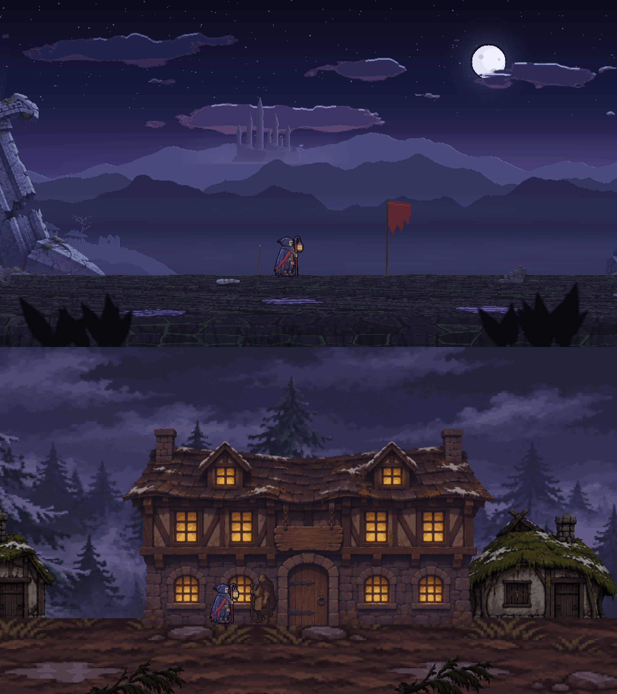
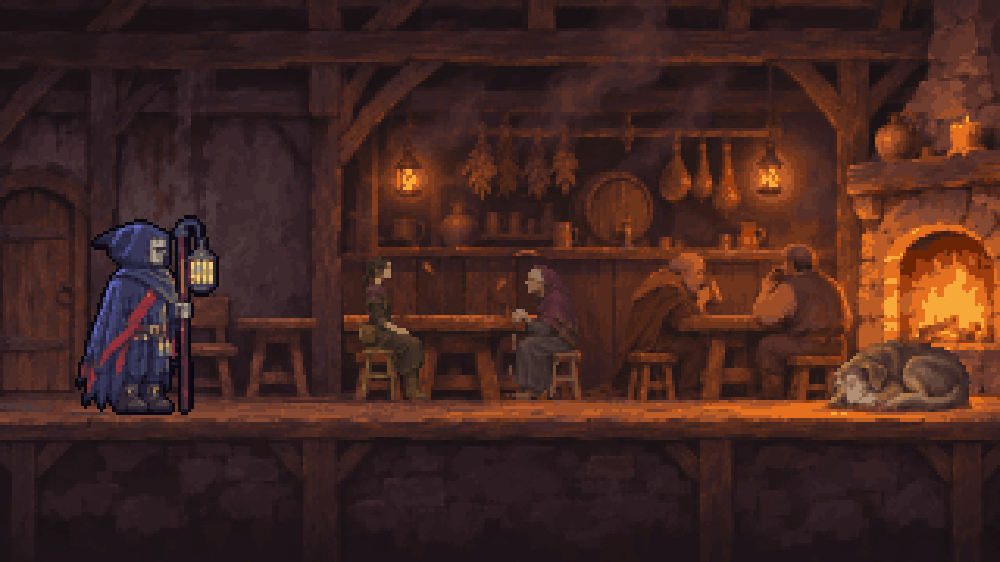
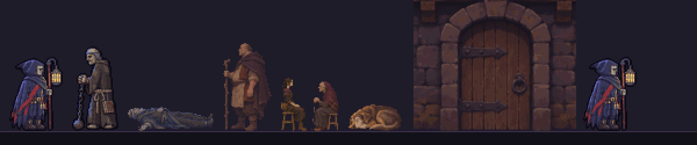
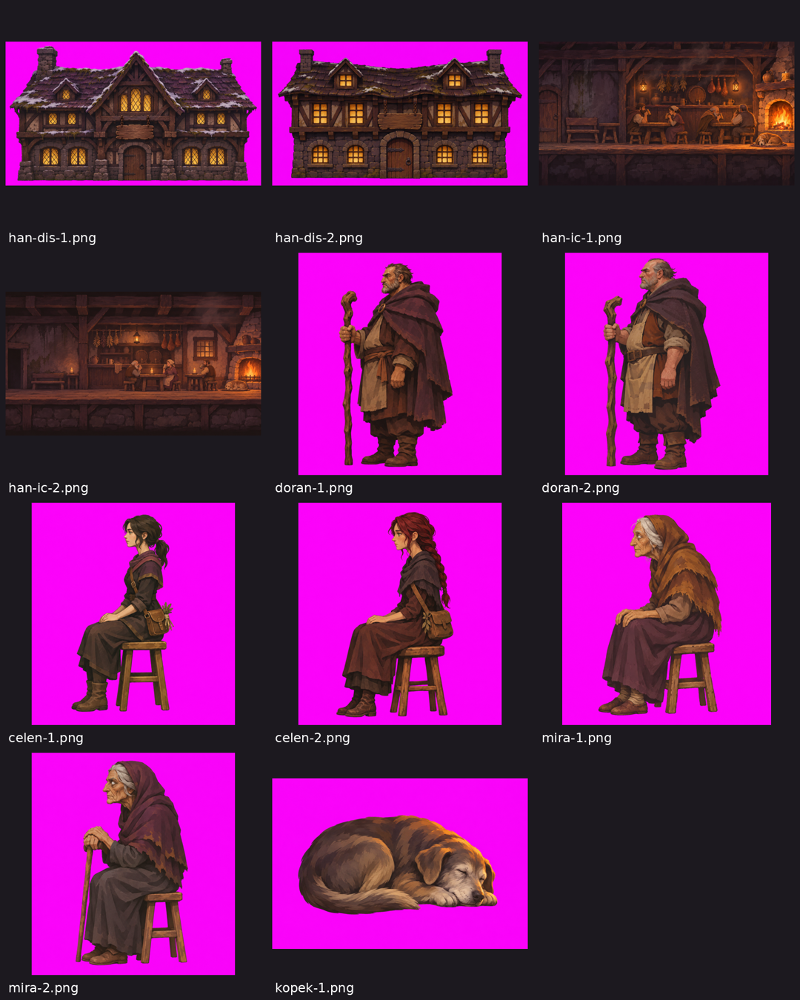
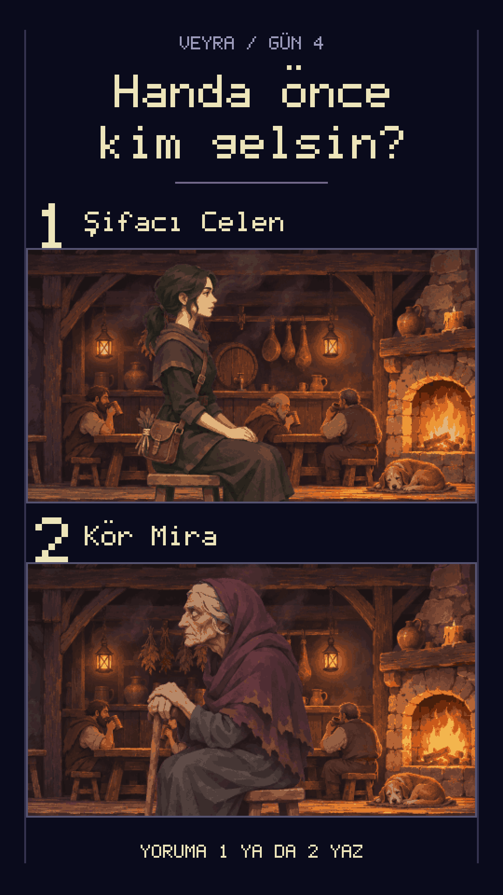

> **Varsayım notu:** Gün 3 videosunun oylaması bu yazı hazırlanırken henüz sayılmamıştı. Han Salonu'nun kazandığını varsayarak yazdım; sonuç farklı çıkarsa bu dosyayı düzelteceğim.

# Gün 4: Eşik Köyü ve Hanın Kapısı

Gün 3'te “Önce nereyi ekleyelim?” diye sormuştum; Han Salonu kazandı. Bugün han için önce bir köy gerekti. Oyuna ikinci harita olarak Eşik köyü girdi, hanın içi de oyunun ilk dövüşsüz yeri oldu.

---

## Bugün Ne Yaptım

Birinci haritanın sonundaki geçitten yürüyünce ekran kararıyor ve Korel Eşik köyünde açılıyor. Arka plan birinci haritadan tamamen farklı: göknar ormanı, yosunlu ve karlı çatılar, çamurlu yol ve sis. Köyün ortasında han duruyor. Kapıda hancı Doran Korel'i durduruyor: “Dur orada. Kuzey yolundan geliyorsun.” Korel: “Sıcak bir köşe istiyorum. Bir bardak su. Param var.” Doran: “Gir. Köşede otur, sessizce. Ben Doran.” Replikler bitmeden kapıdan girilemiyor.

İçeride şömine, masalar, köylüler ve ateşin önünde yaşlı bir köpek var. Korel loş köşedeki sıraya oturabiliyor. Masada şifacı Celen ve kör Mira oturuyor; henüz konuşmuyorlar. Burada dövüş yok. Oyunun ilk iç mekânı bu.

---

## Kullanılan Araçlar ve Teknikler

- **Claude (Kod ve Yönetim):**
  - Han sahnesi, replik sistemi, kapıdaki giriş koşulu ve ışık titremesi kodu.
  - İşi birden çok yapay zekâ ajanına böldü; biri yazdı, başka bir sağlayıcıdan bir denetçi oyunu tarayıcıda oynayıp hata aradı.
- **Codex (Görseller ve köy haritası):** Han cephesi, salon, Doran, Celen, Mira, köpek ve köy katmanları için görsel üretim aracından kaynak görseller; köy haritasının kodu ve haritalar arası kararmalı geçişler.
- **Karma çizim:** Üretilen görselleri kodla piksel ızgarasına ve sınırlı palete indirdim: macenta zemin ayıklama, alan ölçekleme, palet indirgeme ve leke temizleme. Han için `art/han-karma.ts`, köy için `art/koy-karma.ts` çalışıyor.
- **Tarayıcıda oynayarak denetim:** Denetçi, oyunun yayına çıkmamış yerel sürümünü tarayıcıda gerçek tuşlarla oynadı. 319 otomatik doğrulama geçiyor, build başarılı. Oyunun yayındaki web sürümü: [veyra-aksiyon.vercel.app](https://veyra-aksiyon.vercel.app).

---

## Adım Adım

### 1. Köyü Ayrı Bir Harita Yapmak
İlk denemede hanı birinci haritanın ucuna koymuştum. Korel yürüyüp hana varıyordu ama köy hissi yoktu; han, aynı karanlık geçidin sonuna eklenmiş bir bina gibi duruyordu. “Köy ayrı harita olacak” dedim ve han yeni haritaya taşındı.

Birinci haritadan geçiş, geçidin sonunda yürüyerek oluyor ve kararmayla köye açılıyor. Kıyas görselinde iki haritanın farkı net: üstte mor dağlar, ay ve yıkık heykel; altta çamur yol, göknar ormanı ve ışıklı han.

### 2. Köyün Katmanları
Han cephesi, yan evler, göknarlar ve çamur yol ayrı katmanlar olarak üretildi. Yosunlu ve karlı çatıları, hanın sıcak pencereleriyle soğuk sis arasındaki farkı korumak istedim. Sis ve ışık titremesi kodla eklendi; çizim sabit, canlılığı koddan geliyor.

Zemin ilk seferde bulanık şeritlerden oluşuyordu. Köyün geri kalanıyla yan yana gelince okunmadı, yeniden yaptırdım.

### 3. Hanın Kapısında Doran
Kapıda Doran'ın durdurması bir replik sahnesi. Doran “Dur orada. Kuzey yolundan geliyorsun.” der, Korel su ve sıcak bir köşe ister, Doran izin verir. Replikler bitmeden kapıdan girilemiyor. Bunu bir giriş koşulu olarak kodladık: oyuncu kapıya yürüyüp içeri kaçamıyor, önce konuşmayı dinlemek zorunda.

### 4. Salon: İlk Dövüşsüz Yer
Salonu oyunun ilk iç mekânı olarak kurdum. Şömine, masalar, köylüler ve ateşin önünde uyuyan köpek var. Korel loş köşedeki sıraya oturabiliyor. Masada Celen ve Mira oturuyor; henüz konuşmuyorlar. Bu iki karakter, kapanıştaki oylamanın konusu.

Karakterleri Korel ve Zincirli Keşiş'le aynı çizgide yan yana koyup ölçeğe baktım. Doran, Celen, Mira ve köpek, Korel'in yanında ölçek olarak tutuyor.

### 5. Denetçiyle Köyü Gezmek
Yazan ajan işi bitirince başka bir sağlayıcıdan denetçi ajan oyunu tarayıcıda oynadı ve birkaç gerçek hata buldu; bunları aşağıda yazdım. Düzeltmelerden sonra han, köy ve geçiş birlikte çalıştı.

---

## Yapay Zekânın Beceremediği Anlar

1. **Haritayı Sıfırlayan Han:**
   Handan birinci haritaya dönünce oradaki ilerleme sıfırlanıyordu; indirilen düşman geri geliyordu. Denetçi yakaladı.
2. **Yanlış Celen:**
   Oyundaki Celen kızıl saçlıydı, oylama kartındaki Celen koyu saçlı. Oyuna yanlış kaynak görsel girmişti. Kaynak önizlemede iki Celen adayı yan yana duruyor.
3. **129 Piksel Uzaktan Giriş:**
   Kapıdan 129 piksel uzaktayken içeri girilebiliyordu.
4. **Kesik Ev, Havada Çatı:**
   Köyde bir ev dikey bir çizgiyle kesikti ve havada duran bir çatı parçası vardı.
5. **Bulanık Zemin:**
   Köy zemini bulanık şeritlerdi; yeniden yapıldı.
6. **“Taşma Yok” Diyen Kart:**
   Oylama kartında başlık satırları üst üste binmişti. Kartı hazırlayan ajan “taşma yok” demişti.
7. **Takılan Video Kaydı:**
   Video kaydı takılıyordu. Kayıt tarayıcısına başka bir işin dört sekmesi açılmıştı. Kaydı ayrı bir tarayıcıya aldım.

---

## Dersler

- **Başka sağlayıcıdan denetçi:** Yazan ajanın göremediği hatayı oyunu oynayan başka bir ajan gördü. Sıfırlanan ilerleme, uzak kapı ve kesik ev, testlerden değil oynamadan çıktı.
- **“Taşma yok” sözüne değil görsele bak:** Kartı açıp bakmak, ajanın raporundan daha güvenilirdi.
- **Kaynak görseli adıyla seç:** Aynı karakterin iki adayı vardı; yanlış olanı oyuna girdi. Hangi dosyanın seçildiğini not etmek gerekiyor.
- **Kayıt ortamını ayır:** Video kaydı başka işlerle paylaşılan tarayıcıda takıldı. Ayrı tarayıcı sorunu çözdü.
- **Yer yanlışsa taşı:** Hanı birinci haritanın ucunda tutmaya çalışmak yerine ayrı bir harita yapmak daha doğru sonuç verdi.

---

## Bu Gün İzleyiciye Sorulan Soru

“Handa Korel'in yanına önce kim gelsin?” 1: Şifacı Celen. 2: Kör Mira. Yoruma 1 ya da 2 yaz.

---

## Görseller

### 1. Birinci Harita ve Köy Kıyası
Üstte birinci harita: mor dağlar, ay, uzaktaki kale, yıkık heykel ve kırmızı sancak. Altta Eşik köyü: göknar ormanı, hanın ışıklı pencereleri, çamur yol, Korel ve Doran kapının yanında.

### 2. Köyün Tamamı
Han ortada, iki yanında yosunlu ve karlı çatılı evler, arkada göknarlar ve sis. Solda tabela, sağda kızıl göknarlar ve çit. Korel ve Doran hanın kapısı önünde.

### 3. Han Salonu
Solda Korel, ortada masada Celen ve Mira, sağda iki köylü, en sağda şömine ve ateşin önünde uyuyan köpek.

### 4. Karakter Ölçek Kıyası
Soldan sağa: Korel, Zincirli Keşiş, yerde yatan beden, Doran, Celen ve Mira, köpek, han kapısı ve yine Korel.

### 5. Yapay Zekâ Kaynak Görselleri
Macenta zeminli han cepheleri, iç mekân denemeleri, Doran, Celen, Mira ve köpek adayları. Celen'in iki adayından biri koyu, biri kızıl saçlı; oyuna yanlış olan girmişti.

### 6. Gün 4 Oylama Kartı
“Handa önce kim gelsin?”: Şifacı Celen ve Kör Mira seçenekleri; yorumlara 1 ya da 2 yazılacak.

