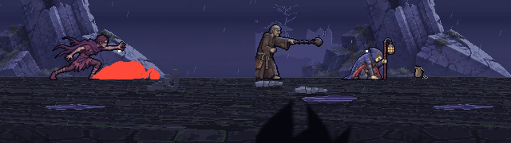
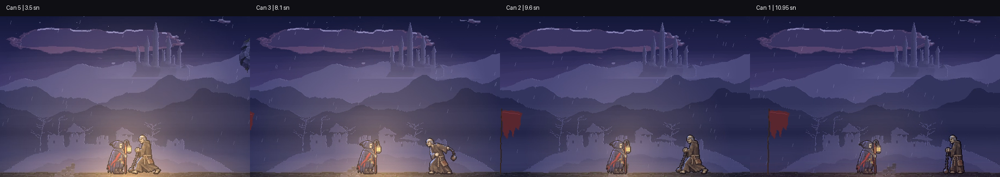
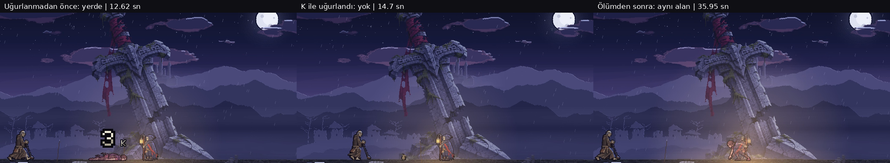
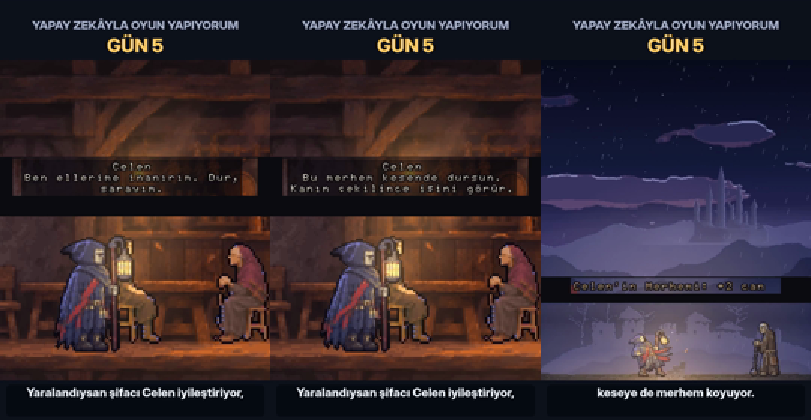
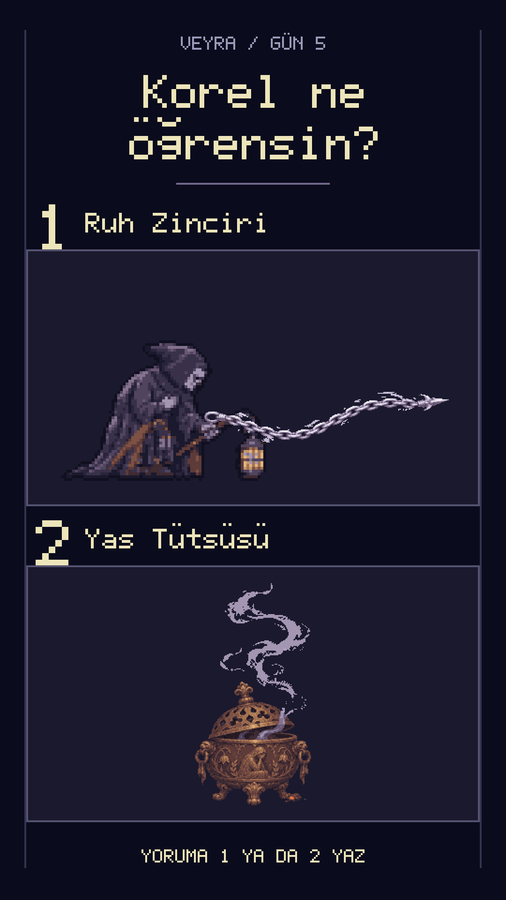

# Gün 5: Ölümün Bedeli ve Kaydın Gösterdiği Hatalar

Gün 4 oylamasını Şifacı Celen 6–2 kazandı. Bugün onu konuşturdum, Korel’i iyileştirmesini ve kesesine merhem koymasını ekledim. Bunun yanında mevcut oyunu cilaladım: beş can, ölümden dönüş, kaçış ve iki yeni düşman. Ama günün asıl dersi, bunları eklediğini söyleyen bir ajanla kayıtta gerçekten gösteren bir ajanın aynı işi yapmadığıydı.

---

## Bugün Ne Yaptım

Korel’in artık beş canı var. Canı bir çubuktan değil fenerden okuyorum; hasar aldıkça ışığı azalıyor. Can bitince Korel yere düşüyor, ekran kararıyor ve “Henüz değil.” yazısından sonra dönüş noktasında kalkıyor. Bunun bedeli var: dönüş noktasının önünde uğurladığım düşmanlar geri geliyor. Gerisinde uğurladıklarım gitmiş kalıyor.

Hızlı Gölge ve Ağır Kalıntı’yı ekledim; birinin atılışından, diğerinin yumruğundan kaçışla sıyrılabiliyorum. Toplanan eşyalar için kese de var. Handa Celen canı beşe tamamlıyor ve keseye en fazla bir merhem koyuyor. Dövüşte can bire düşünce merhem kendiliğinden kullanılıp iki can veriyor. Bitince Celen’den yenisini alabiliyorum.

Bu sayfa, Gün 4’ten sonraki cila turunu ve Gün 5 hazırlığını birlikte anlatıyor. [Web demosu](https://veyra-aksiyon.vercel.app) üzerinden oyun denenebilir; burada kaynak kodunu değil, geliştirme yöntemini paylaşıyorum.

---

## Kullanılan Araçlar ve Teknikler

- **Yazan ve denetleyen ayrı ajanlar:** Celen ve merhem işini Codex yazdı, ayrı denetçi gözden geçirdi. Video için de bağımsız bir denetçi, seriyi ve oyunu bilmeyen izleyici gözüyle baktı.
- **Ekran kaydı ve olay zamanları:** Ajanlardan yalnız sonuç raporu değil, hasar, uğurlama, ölüm ve geri dönüş anlarının kaydını aldım. Fener ve geri dönüş için kesintisiz yeni çekimler yapıldı.
- **FFmpeg ile kare karşılaştırması:** Kaydın içinden seçilen anları yan yana koyduk. Önceki ve sonraki durumu aynı sahnede görmek, tek bir güzel ekran görüntüsünden daha açıklayıcı oldu.
- **Metin–görüntü eşlemesi:** Video metnindeki her cümlenin hangi görüntüyle karşılanacağı yazıldı. “Alev küçülüyor” sözüne yalnız fenerin görünmesi yetmedi; değişimin de seçilmesi gerekti.

---

## Adım Adım

### 1. Ölüm Kuralını Oynanabilir Hâle Getirmek

İlk dönüş noktası düzeninde Korel düşmanın çok yakınında doğabiliyordu. Ölümden kalkıp yeniden darbe almak, oyuncuya toparlanacak alan bırakmıyordu. Dönüş noktalarını düşman menzilinden uzaklaştırdık.

Kuralı da netleştirdim: Ölünce herkes geri gelmiyor. Yalnız dönüş noktasının önünde uğurlanan düşmanlar geri geliyor; gerisinde uğurlananlar gitmiş kalıyor. Geride uğurlanmamış bir düşman varsa daha ilerideki dönüş noktası seçilmiyor. Bu değişiklikten sonra eski ölüm çekiminin senaryosu da geçersiz kaldı. Dönüşün gerisinde uğurlanan birini, ölümün bedeli diye geri gelmiş gibi gösteremezdik.

Yeni kayıtta Gölge önce yere indirildi, uğurlandı ve yok olduğu alan gösterildi. Ardından Korel öldü, kalktı ve aynı karşılaşma alanına geri yürüdü. Aynı Gölge yeniden oradaydı. Düşman tam uğurlandığı pikselde doğmuyor; başlangıç yerine dönüp hareket ediyor. Aşağıdaki kıyas bu yüzden aynı anıtın önündeki üç durumu gösteriyor.

### 2. Oylamanın Kazananına Bir İş Vermek

Celen’i yalnız yeni replikleri olan bir karakter yapmak istemedim. Handa yarayı iyileştiriyor, sonrasında dövüşte kullanılacak merhemi veriyor. Merhem de ayrıca basılacak bir tuş istemiyor; can bire inince kendiliğinden iki can ekliyor.

Burada iki ayrı şeyi doğrulamak gerekiyor: can değerinin gerçekten artması ve izleyicinin bunu görüntüden anlaması. İlk video denetiminde konuşma görülüyordu ama iyileşmenin sonucu açıkça seçilmiyordu. Merhemin “+2 can” bildiriminin sonu da kadrajın dışında kalıyordu. Mekaniğin çalışması, onu anlatan videonun anlaşılır olmasını sağlamadı.

### 3. Metni Önceki Günleri Bilmeyen Biri İçin Yeniden Yazmak

İlk metin “Korel artık ölebiliyor…” diye açılıyordu. Korel’i tanımayan biri için bu açılış geçmiş bilgi istiyordu. Üstelik can, düşman, kaçış ve Celen aynı düzeyde bir eklenenler listesi gibi sıralanmıştı. Metni ve kayıtları beğenmedim; üç yeni yaklaşım hazırlandı.

Seçtiğim açılış “Bu devin yumruğundan kaçabilir miydin?” oldu. İlk görüntü de Ağır Kalıntı’nın yumruğu. Karakter adını öğrenmeden tehlike anlaşılabiliyor. Devamını tehlike, ölüm, kalkış, bedel ve iyileşme sırasına bağladık.

Ajanın önerdiği başka bir metinde “Kendi kahramanımı öldürmek zoruma gitti” yazıyordu. Kaynak metin bile bu duygunun bana ait olup olmadığının sorulması gerektiğini belirtiyordu. O yaklaşımı seçmedim. Akıcı bir cümle yazılabilmesi, benim öyle hissettiğim anlamına gelmiyor.

### 4. Denetçiden “Güzel Olmuş” Yerine Kanıt İstemek

Bağımsız video denetçisi, “alevi küçülüyor” denirken küçülmenin okunmadığını, geri gelen düşmanın ise yeni gelen biri gibi de anlaşılabileceğini söyledi. Geniş planlarda karakter ve oyun yazıları küçülüyor, merhem bildirimi kırpılıyordu. Bunlar oyunu bilen kişinin kolayca tamamladığı, ilk kez görenin ise kaçırabileceği boşluklardı.

Fener için farklı can kademelerini gösteren yeni kayıt alındı. Geri dönüş için de “yerde → uğurlandı, yok → ölümden sonra aynı alan” zinciri çekildi. Aşağıdaki iki karşılaştırma bu çekimlerden. İlk kayıtta fenerin görünmesiyle küçülmesinin anlaşılması aynı şey sanılmıştı; yan yana kareler bu farkı somutlaştırdı.

### 5. Çekimde Ölüm Hatasını Bulmak

Eski ölüm kaydında Korel’in normal renkleri kaybolup parlak kırmızı bir siluete dönüştüğünü gördük. Ölümcül darbenin hasar parlaması ölüm boyunca temizlenmiyordu. Pozlar vardı ama renk onları örtüyordu.

17 Kasım’daki düzeltmeyle ölüm başlarken hasar boyası temizlendi. Yeniden çekimde Korel’in kapüşonu ve pelerini kendi renginde görüldü. Önce/sonra kıyasını aşağıya koydum. Burada ekran kaydı yalnız video malzemesi olmadı; oyundaki bir görsel hatayı da ortaya çıkardı.

---

## Yapay Zekânın Beceremediği Anlar

1. **Eklenenler Listesi Gibi Metin:** İlk anlatım, oyunu geliştiren kişinin bildiklerini sıralıyordu. Önceki bölümleri bilmeyen izleyici için soru ve sahne akışıyla yeniden yazmak gerekti.
2. **Sözü Kanıtlamayan Görüntü:** Fener ekrandaydı ama küçülmesi okunmuyordu. Düşman geliyordu ama daha önce uğurlanan düşman olduğu anlaşılmıyordu. İkisi için de yeni çekim gerekti.
3. **Ölüm Boyunca Kalan Kırmızı Siluet:** Hasar parlaması ölüm pozlarını örtüyordu. Düzeltmeyi yeni kayıtla karşılaştırdık.
4. **Eski Kuralla Çalışan Çekim:** Dönüş kuralı değişince önceki uğurlama senaryosu aynı sonucu vermedi. Kayıt betiğindeki eski saldırı ve kaçış tuşları da yeni eşlemeyle uyuşmuyordu; yeni çekim dalları güncel tuşlarla hazırlandı.
5. **İsimleri Olan Ama İşlevi Açıklanmayan Seçenekler:** Denetçi, Ruh Zinciri ve Yas Tütsüsü kartında nasıl oy verileceğinin açık, neyin seçildiğinin ise eksik olduğunu buldu. Yas Tütsüsü’nün oyundaki karşılığı henüz kararlaştırılmadığı için bu boşluğu uydurma bir yetenek açıklamasıyla doldurmadım.

---

## Dersler

- **Yazanla denetleyeni ayır:** İşi yapanın raporuna ek olarak, sonucu ilk kez gören birinin değerlendirmesi gerekti. Video denetçisi mekanik ile görüntü arasındaki boşluğu yakaladı.
- **Her iddia için önce ve sonra iste:** “Azaldı”, “iyileşti”, “geri geldi” sözleri değişim anlatıyor. Tek durumun karesi bu değişimi göstermeyebilir.
- **Kural değişince çekim senaryosunu da yenile:** Oyunun eski davranışını gösteren kayıt, yeni metne kendiliğinden uymaz. Tuş eşlemeleri de kayıt betiğinin parçası.
- **Modelin yazdığı duyguyu kendine mal etme:** Bana ait olduğu doğrulanmamış bir his, iyi bir açılış uğruna anlatıya girmemeli.
- **Düzeltmenin sınırını açık tut:** Yeni fener ve geri dönüş kayıtları var diye videodaki bütün denetim maddeleri kapanmış sayılmaz. Her düzeltme kendi kanıtıyla kontrol edilmeli.

## Bilinen Eksik

Denetçinin fener, geri gelen düşman, bantlar, merhem yazısı ve karanlıkla ilgili bulguları yeniden çekim ve ikinci kurguyla giderildi. Oylama kartına yetenek açıklaması bilinçli olarak eklenmedi; özellikle Yas Tütsüsü’nün oyundaki işlevi henüz kararlaştırılmadı.

---

## Bu Gün İzleyiciye Sorulan Soru

“Kahraman Korel ne öğrensin?” 1: Ruh Zinciri. 2: Yas Tütsüsü. Yoruma 1 ya da 2 yaz.

Bu seçenekleri yapılmış yetenekler diye sunmuyorum. Özellikle Yas Tütsüsü’nün oyundaki işlevi, kazanırsa kararlaştırılacak.

---

## Görseller

### 1. Ölümde Kırmızı Siluet: Önce ve Sonra

Sol karedeki kırmızı leke eski kayıttaki Korel, yanındaki kahverengi figür ise düşman. Sağda Korel’in düzeltmeden sonraki normal renkli çöküş pozu var. Farklı ölüm anları karşılaştırılıyor; aynı animasyon karesinin renk kıyası değil:

### 2. Fenerin Canla Değişmesi

Soldan sağa can 5, 3, 2 ve 1. Can azaldıkça ışık halkası daralıyor; ancak can 3, 2 ve 1 arasındaki fark ince. Bu kıyas alevin bütün hareketini göstermiyor:

### 3. Uğurlanan Gölgenin Geri Dönüşü

Solda yerdeki Gölge, ortada uğurlandıktan sonra boş kalan yer, sağda Korel’in ölümünden sonra aynı karşılaşma alanındaki canlı Gölge. Aradaki ölüm ve yürüyüş bu üç karede yer almıyor:

### 4. Celen ve Merhem

İkinci video sürümünün kare tablosundan seçme: Celen’le konuşma, merhem repliği ve dövüşte “+2 can” bildirimi. Bu sabit kareler tek başına canın önceki ve sonraki değerini kanıtlamıyor:

### 5. Gün 5 Oylama Kartı

Ruh Zinciri ve Yas Tütsüsü seçenekleri. Denetçinin işlev açıklaması eksik bulduğu kart:

